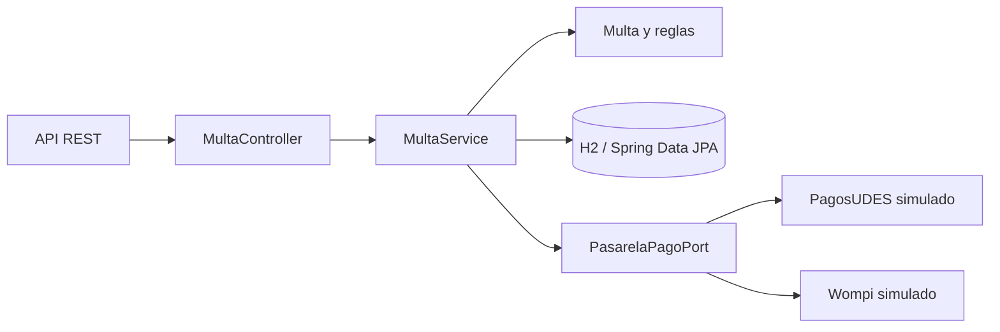

# Unidad 7 — API de multas de biblioteca

Servicio REST de ejemplo para generar multas, consultar las multas de un estudiante y registrar pagos de ventanilla o en línea. El proyecto Spring Boot está en [`multas-biblioteca-api`](multas-biblioteca-api/). Las integraciones PagosUDES y Wompi son simulaciones locales: no procesan dinero ni hacen llamadas externas.

## Requisitos y ejecución

Java 17 o superior y Maven 3.9 o superior.

```bash
cd multas-biblioteca-api
mvn clean package
mvn spring-boot:run
```

La aplicación usa una base H2 en memoria (`multas_biblioteca_db`) y crea el esquema al iniciar. PagosUDES es el proveedor predeterminado. Para seleccionar Wompi:

```bash
mvn spring-boot:run -Dspring-boot.run.arguments=--app.pagos.proveedor=wompi
```

Se puede simular un rechazo con el concepto `SIMULAR_RECHAZO` o activando `app.pagos.simulacion.fallar=true`.

## Rutas principales

| Método | Ruta | Resultado |
|---|---|---|
| `POST` | `/api/multas` | Crea una multa validada (201). |
| `GET` | `/api/multas` | Lista las multas. |
| `GET` | `/api/multas/{id}` | Consulta una multa (404 si no existe). |
| `GET` | `/api/multas/estudiante/{estudianteId}` | Lista por estudiante. |
| `PATCH` | `/api/multas/{id}/pagar` | Registra pago en ventanilla. |
| `POST` | `/api/multas/{id}/pagar-en-linea` | Solicita pago al proveedor configurado (402 si se rechaza). |

El monto es de $500 COP por día de atraso, con tope de $15.000 COP. Se permiten como máximo tres multas pendientes por estudiante. Una multa pagada no admite un segundo pago (409); solicitudes inválidas reciben 400.

Ejemplo de creación:

```http
POST /api/multas
Content-Type: application/json

{"estudianteId":"E-100","concepto":"Retraso en devolución del libro L-21","diasAtraso":4}
```

El monto esperado es $2.000 COP. Para registrar el pago, usa el `id` de la respuesta:

```http
PATCH /api/multas/1/pagar
POST /api/multas/1/pagar-en-linea
```

## Diagrama



## Decisiones y costos

1. **Cálculo dentro de `Multa`.** Mantiene el tope y el valor diario junto al dato que protegen; el costo es que cambiar la regla requiere modificar el dominio.
2. **Límite con conteo SQL.** `countByEstudianteIdAndEstado` evita cargar todas las multas del estudiante; requiere un método derivado específico en el repositorio.
3. **Proveedor seleccionado al iniciar.** `@ConditionalOnProperty` mantiene la elección por configuración y deja el servicio sin decisiones sobre marcas; no sirve si se necesita elegir una pasarela distinta para cada transacción.
4. **Respuesta neutral del puerto.** `ResultadoPago` expone éxito, referencia y mensaje comunes; los adaptadores deben traducir los formatos de cada proveedor.

La primera parte conserva capas `controller → service → model/repository`. La segunda agrega una frontera de puerto y adaptadores para aislar pagos. El costo es más clases de configuración; el beneficio es cambiar el proveedor sin cambiar las reglas de la multa.

## Evidencia y estructura

Las pruebas de dominio y compilación se ejecutan con `mvn clean package` desde `multas-biblioteca-api`. Para comprobar manualmente, crea una multa y consulta su estado antes y después de pagar. La evidencia de diseño está en [`docs/decisiones.md`](docs/decisiones.md).

```text
multas-biblioteca-api/  Aplicación Spring Boot, Maven y pruebas
docs/                   Decisiones, resultados y pasos reproducibles
```
